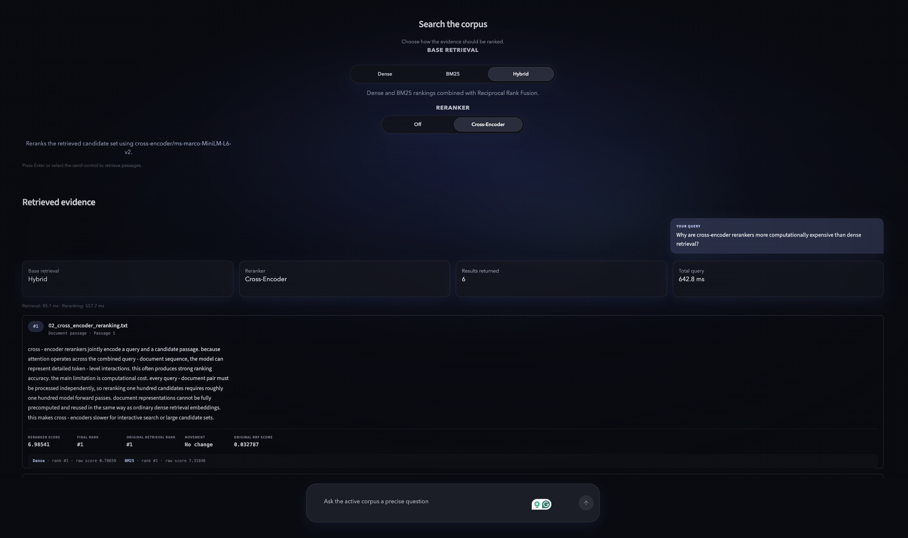
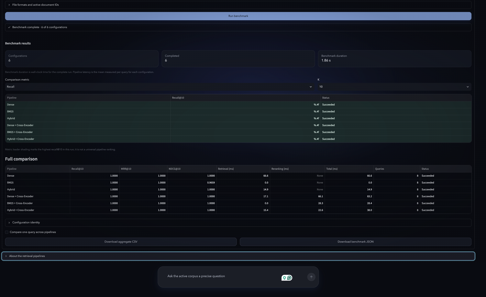
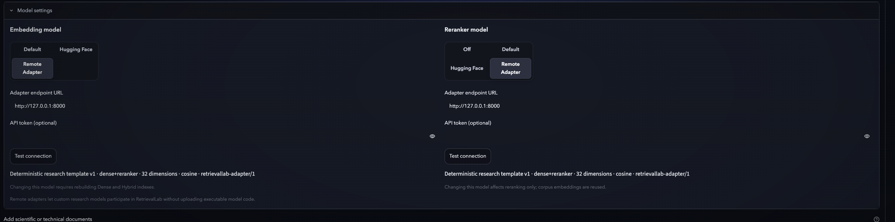

# RetrievalLab

**A modular inference, evaluation, and benchmarking workbench for information retrieval systems.**

RetrievalLab is a modular workbench for running, evaluating, and comparing information-retrieval pipelines on user-provided corpora. It supports lexical, dense, hybrid, and reranked retrieval; compatible Hugging Face models can be swapped directly, while non-standard research architectures can integrate through a versioned remote adapter interface.

RetrievalLab focuses on **retrieval inference, evaluation, and comparison—not LLM answer generation**.

---

## Retrieval and reranking

Run Dense, BM25, or Hybrid retrieval over the same indexed corpus, then optionally rerank the fixed first-stage candidate set with a CrossEncoder while preserving retrieval scores, original ranks, rank movement, and pipeline provenance.



## Evaluation and benchmarking

Evaluate retrieval with labeled queries and relevance judgments, or compare multiple retrieval and reranking configurations under the same corpus, query set, candidate depth, and metric implementation.



## Bring your own retriever or reranker

Compatible Hugging Face models can be selected directly. Non-standard research architectures can participate through the versioned `retrievallab-adapter/1` remote inference protocol without uploading executable model code or arbitrary checkpoints.



---

## Key capabilities

- Dense semantic retrieval with a local exact vector index
- Okapi BM25 lexical retrieval
- Hybrid Dense + BM25 retrieval using Reciprocal Rank Fusion (RRF)
- Optional CrossEncoder reranking over a fixed first-stage candidate set
- Compatible Hugging Face SentenceTransformer embedding models
- Compatible Hugging Face CrossEncoder reranking models
- Remote adapters for custom research retrievers and rerankers
- PDF, DOCX, TXT, and BEIR-style corpus JSONL ingestion
- Passage chunking and session-local indexing
- Retrieval provenance, component scores, rank movement, and latency diagnostics
- Document-level Recall@K, Hit Rate@K, MRR@K, and NDCG@K
- Controlled multi-pipeline benchmarking
- Aggregate CSV and detailed JSON benchmark export

## How RetrievalLab works

1. Upload a corpus and build a shared passage collection.
2. Select a built-in, Hugging Face-compatible, or remote dense model.
3. Run Dense, BM25, or Hybrid retrieval against the same active corpus.
4. Optionally rerank the retrieved candidate set with a local or remote reranker.
5. Inspect ranked passages, component scores, latency, and retrieval provenance.
6. Evaluate one pipeline with query JSONL and qrels TSV files.
7. Benchmark multiple configurations under the same corpus, queries, judgments, and candidate depth.

Corpus embeddings and indexes are reused across queries. Changing the dense model invalidates the Dense and Hybrid indexes, while changing the reranker reuses the existing first-stage indexes.

## Supported retrieval configurations

| Configuration | First stage | Optional second stage |
| --- | --- | --- |
| Dense | Selected dense encoder + exact vector search | Selected reranker |
| BM25 | Okapi BM25 | Selected reranker |
| Hybrid | Dense and BM25 rankings fused with RRF | Selected reranker |

The benchmark workspace can compare:

- Dense
- BM25
- Hybrid
- Dense + reranker
- BM25 + reranker
- Hybrid + reranker

These are controlled comparisons under shared evaluation conditions—not a claim that any one pipeline is universally best.

## Model integration

RetrievalLab supports three practical model-integration levels.

### Built-in

The default models are:

- Dense encoder: `Snowflake/snowflake-arctic-embed-s`
- Reranker: `cross-encoder/ms-marco-MiniLM-L6-v2`

### Hugging Face-compatible

Enter a Hugging Face Hub model ID for a compatible SentenceTransformer embedding model or `sentence_transformers.CrossEncoder` model.

RetrievalLab validates the model ID, loads models with `trust_remote_code=False`, and infers the embedding dimension where required. The selected model must be compatible with the corresponding Sentence Transformers interface.

### Custom research architecture

Models that do not follow the Sentence Transformers interfaces can integrate through the versioned `retrievallab-adapter/1` HTTP protocol.

Researchers implement a small inference adapter around their own architecture rather than modifying RetrievalLab itself.

RetrievalLab remains responsible for:

- corpus parsing and chunking
- local indexing
- retrieval orchestration
- reranking orchestration
- evaluation
- benchmarking
- diagnostics
- exports

The external adapter performs only compatible model inference, such as:

- query encoding
- document encoding
- passage reranking scores

See the [remote adapter protocol and deployment guide](docs/adapter_protocol.md) and the [standalone adapter example](examples/remote_adapter/).

## Evaluation details

Evaluation accepts:

- **Query JSONL** — one object per line containing `_id` and `text`
- **Qrels TSV** — `query-id`, `corpus-id`, and a non-negative relevance score; the header is optional

Results are evaluated at the **document level**. Multiple passages originating from the same document are deduplicated before metric cutoffs.

RetrievalLab reports:

- Recall@1 / 3 / 5 / 10
- Hit Rate@1 / 3 / 5 / 10
- MRR@1 / 3 / 5 / 10
- NDCG@1 / 3 / 5 / 10
- mean retrieval latency
- mean reranking latency
- mean total query latency

NDCG supports graded relevance judgments.

Benchmarking runs selected pipeline configurations against the same active corpus, query set, qrels, metric implementation, and candidate depth.

Aggregate results can be exported as CSV. Detailed JSON export includes configuration identity, metrics, latency, failures, warnings, and per-query diagnostics.

Evaluation is bounded by the configured first-stage candidate depth; it cannot measure a relevant document that was never retrieved into that candidate set.

## Architecture

```text
Corpus
  ↓
Parsing + Chunking
  ↓
Shared Passages
  ├── Dense Encoder Adapter ── Built-in / Hugging Face / Remote
  │        ↓
  │    Exact Vector Index
  └── BM25 Index
           ↓
Dense / BM25 / Hybrid (RRF) Retrieval
  ↓
Optional Reranker Adapter ── Built-in / Hugging Face / Remote
  ↓
Ranked Passages
  ↓
Evaluation + Benchmarking
  ↓
Metrics / Diagnostics / CSV + JSON Export
```

Parsing, chunking, model adapters, indexes, retrieval engines, reranking, evaluation, benchmarking, and presentation remain separate modules.

Dense retrieval uses normalized embeddings and exact inner-product search. FAISS `IndexFlatIP` is used on supported platforms, with an exact NumPy fallback on macOS.

## Corpus and input support

### PDF

- Page-aware text extraction
- Chunks do not cross page boundaries
- Image-only or empty pages are reported
- OCR is intentionally not included

### DOCX

- Extracts non-empty paragraph text

### TXT

- Accepts UTF-8 text
- Invalid UTF-8 bytes are replaced and reported

### JSONL

BEIR-style corpus records are supported with:

- required `_id`
- required `text`
- optional `title`

### Default indexing profile

- 350-token chunks
- 50-token overlap
- candidate depth of 100
- 10 displayed search results

The local workbench accepts up to:

- 20 uploaded files
- 50 MB total upload size
- 35,000 indexed passages

A bounded slice mode is available for a single larger JSONL corpus; results then cover only the active slice.

## Installation and local usage

```bash
git clone https://github.com/rdaslam12/RetrievalLab.git
cd RetrievalLab

python -m venv .venv
source .venv/bin/activate

python -m pip install --upgrade pip
python -m pip install -r requirements.txt

python -m streamlit run app.py
```

On Windows, activate the environment with:

```powershell
.venv\Scripts\activate
```

Then run:

```powershell
python -m streamlit run app.py
```

Open the Streamlit URL, upload a corpus, choose the retrieval and model settings, then select **Index corpus**.

The first use of a selected Hugging Face model may download it into the local model cache.

CUDA is preferred when available, followed by Apple MPS and CPU. Runtime fallbacks are handled where required by the selected model and platform.

## Remote adapter usage

The repository includes a deterministic development adapter demonstrating the `retrievallab-adapter/1` protocol.

Create a separate environment for the example:

```bash
python -m venv /tmp/retrievallab-adapter-env

/tmp/retrievallab-adapter-env/bin/pip install \
  -r examples/remote_adapter/requirements.txt

cd examples/remote_adapter

/tmp/retrievallab-adapter-env/bin/uvicorn \
  server:app \
  --host 127.0.0.1 \
  --port 8000
```

From the RetrievalLab repository root, enable local adapter connections:

```bash
RETRIEVALLAB_ALLOW_LOCAL_ADAPTERS=1 python -m streamlit run app.py
```

In **Model settings**:

1. Choose **Remote Adapter** for the embedding model and/or reranker.
2. Enter:

   ```text
   http://127.0.0.1:8000
   ```

3. Select **Test connection**.

A successful connection displays the adapter's reported protocol, model name, capabilities, dimensions, and similarity configuration where applicable.

The bundled server is a deterministic development template—not a production model service.

For endpoint schemas, authentication guidance, deployment requirements, validation rules, and transport limits, see [docs/adapter_protocol.md](docs/adapter_protocol.md).

## Testing

The default test suite is designed to run offline using deterministic model doubles.

```bash
python -m compileall -q app.py src scripts tests examples
python -m pytest -q
python scripts/smoke_test.py
git diff --check
```

Real-model smoke tests are opt-in because they may download model weights:

```bash
RUN_MODEL_SMOKE=1 \
python -m pytest -q tests/test_real_model_smoke.py
```

```bash
RUN_RERANKER_SMOKE=1 \
python -m pytest -q tests/test_real_reranker_smoke.py
```

The release validation also covers Streamlit startup, retrieval pipelines, reranking, evaluation, benchmarking, exports, and the deterministic remote-adapter workflow.

## Security and privacy boundaries

- RetrievalLab does not execute arbitrary uploaded Python code.
- RetrievalLab does not load arbitrary user-uploaded checkpoints.
- Hugging Face models are selected through validated Hub IDs.
- `trust_remote_code=True` is not used.
- Custom architectures integrate through remote adapters rather than executable uploads.
- Remote endpoint schemes, destinations, redirects, metadata, payload sizes, response shapes, vector dimensions, and numeric values are validated.
- Adapter tokens remain session-scoped and are excluded from adapter identities and benchmark exports.
- Uploaded corpus data, passages, embeddings, indexes, evaluation inputs, and results remain session-local unless external inference is explicitly configured.
- When a remote adapter is enabled, the query and/or document text required for inference is sent to that configured endpoint.
- Network and protocol validation reduce risk but do not make an untrusted external service inherently safe.

Use only remote endpoints whose operator and data-handling policy you trust.

## Current limitations

- Remote adapters require a separately hosted endpoint implementing the compatible protocol.
- Arbitrary checkpoint, model-file, and Python-file uploads are intentionally unsupported.
- The remote protocol covers the implemented dense-encoding and reranking contracts rather than every possible information-retrieval paradigm.
- Benchmark latency depends on hardware, model state, corpus size, runtime conditions, and—in the remote case—network overhead.
- Hugging Face model availability and downloads depend on the selected model and network/cache state.
- Evaluation is bounded by the configured candidate depth, currently 100 or the corpus size when smaller.
- OCR is not included.
- Model training is outside the current scope.
- Automatic benchmark-dataset downloading is outside the current scope.
- Durable corpus persistence is outside the current scope.
- LLM answer generation is outside the current scope.

## Research origin and confidentiality

RetrievalLab originated from deployment and evaluation work around an ongoing retrieval and reranking research project.

Unpublished research implementations, trained checkpoints, experimental configurations, and private research artifacts are intentionally excluded from this public repository while the associated work is under review.

## Project status

RetrievalLab is feature-complete for its current scope: retrieval inference, optional reranking, document-level evaluation, controlled multi-pipeline benchmarking, diagnostics, export, and standardized model integration.

It intentionally stops at ranked evidence and does not add an LLM answer-generation or chatbot layer.